<!-- ASCII edition. SVG panels keep the palette consistent across GitHub themes. -->

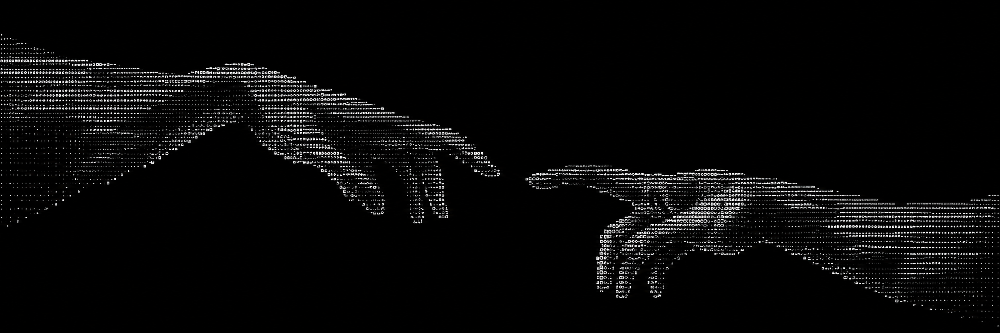

<picture><source media="(max-width: 600px)" srcset="./assets/ascii/mobile-identity.svg" />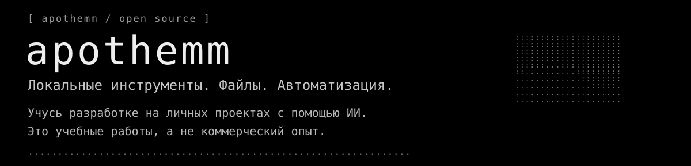</picture>

<picture><source media="(max-width: 600px)" srcset="./assets/ascii/mobile-stack.svg" />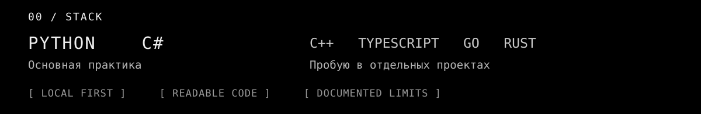</picture>

<picture><source media="(max-width: 600px)" srcset="./assets/ascii/mobile-selected.svg" />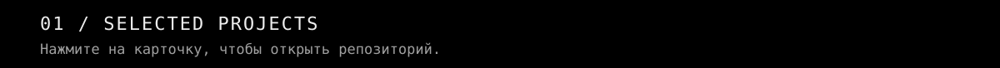</picture>

<a href="https://github.com/apothemm/access-map"><picture><source media="(max-width: 600px)" srcset="./assets/ascii/mobile-access-map.svg" />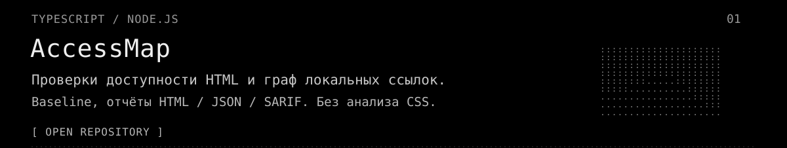</picture></a>

<a href="https://github.com/apothemm/doc-harbor"><picture><source media="(max-width: 600px)" srcset="./assets/ascii/mobile-doc-harbor.svg" />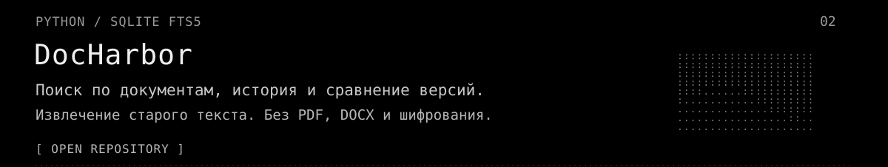</picture></a>

<a href="https://github.com/apothemm/vault-trail"><picture><source media="(max-width: 600px)" srcset="./assets/ascii/mobile-vault-trail.svg" />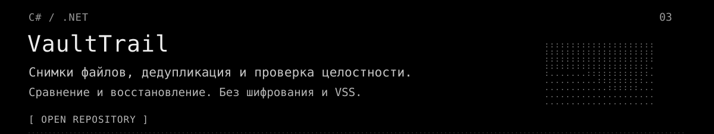</picture></a>

<a href="https://github.com/apothemm/diffsignal"><picture><source media="(max-width: 600px)" srcset="./assets/ascii/mobile-diffsignal.svg" />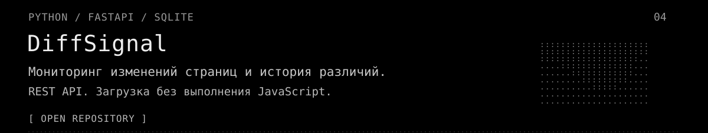</picture></a>

<a href="https://github.com/apothemm/sortmate"><picture><source media="(max-width: 600px)" srcset="./assets/ascii/mobile-sortmate.svg" />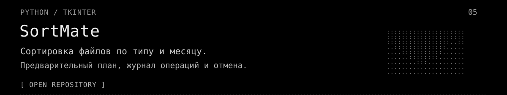</picture></a>

<a href="https://github.com/apothemm/workdesk"><picture><source media="(max-width: 600px)" srcset="./assets/ascii/mobile-workdesk.svg" />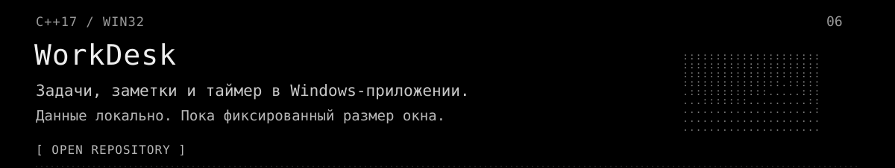</picture></a>

<picture><source media="(max-width: 600px)" srcset="./assets/ascii/mobile-archive.svg" />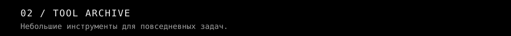</picture>

<a href="https://github.com/apothemm/log-workbench"><picture><source media="(max-width: 600px)" srcset="./assets/ascii/mobile-archive-log-workbench.svg" />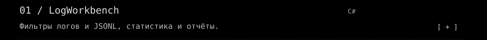</picture></a>

<a href="https://github.com/apothemm/csv-scout"><picture><source media="(max-width: 600px)" srcset="./assets/ascii/mobile-archive-csv-scout.svg" />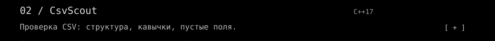</picture></a>

<a href="https://github.com/apothemm/link-pulse"><picture><source media="(max-width: 600px)" srcset="./assets/ascii/mobile-archive-link-pulse.svg" />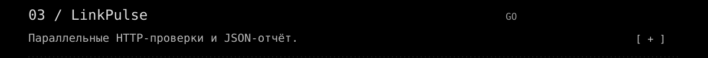</picture></a>

<a href="https://github.com/apothemm/hash-ledger"><picture><source media="(max-width: 600px)" srcset="./assets/ascii/mobile-archive-hash-ledger.svg" /></picture></a>

<a href="https://github.com/apothemm/repo-lens"><picture><source media="(max-width: 600px)" srcset="./assets/ascii/mobile-archive-repo-lens.svg" />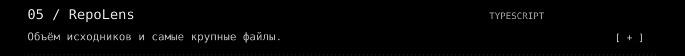</picture></a>

<a href="https://github.com/apothemm/dupe-radar"><picture><source media="(max-width: 600px)" srcset="./assets/ascii/mobile-archive-dupe-radar.svg" />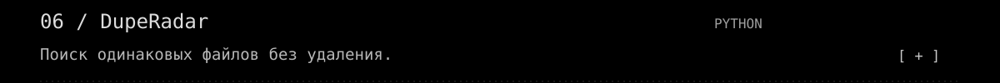</picture></a>

<a href="https://github.com/apothemm/systemscope"><picture><source media="(max-width: 600px)" srcset="./assets/ascii/mobile-archive-systemscope.svg" />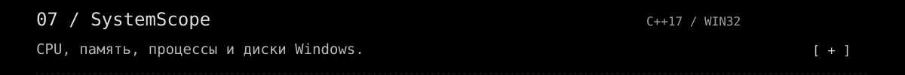</picture></a>

<a href="https://github.com/apothemm/disk-lens"><picture><source media="(max-width: 600px)" srcset="./assets/ascii/mobile-archive-disk-lens.svg" />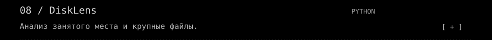</picture></a>

<a href="https://github.com/apothemm/snippet-shelf"><picture><source media="(max-width: 600px)" srcset="./assets/ascii/mobile-archive-snippet-shelf.svg" />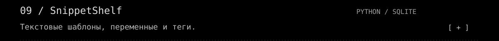</picture></a>

<a href="https://github.com/apothemm/focus-harbor"><picture><source media="(max-width: 600px)" srcset="./assets/ascii/mobile-archive-focus-harbor.svg" />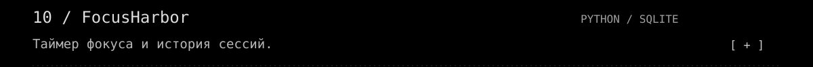</picture></a>

<a href="https://github.com/apothemm/sharesafe"><picture><source media="(max-width: 600px)" srcset="./assets/ascii/mobile-archive-sharesafe.svg" />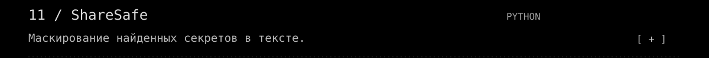</picture></a>

<a href="https://github.com/apothemm/windows-first-aid"><picture><source media="(max-width: 600px)" srcset="./assets/ascii/mobile-archive-windows-first-aid.svg" />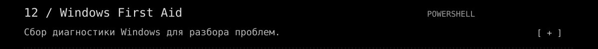</picture></a>

<picture><source media="(max-width: 600px)" srcset="./assets/ascii/mobile-current.svg" />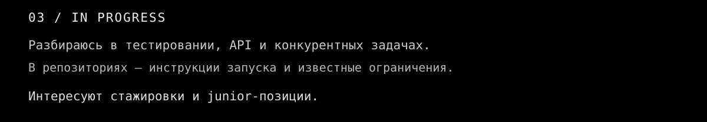</picture>

<picture><source media="(max-width: 600px)" srcset="./assets/ascii/mobile-contact.svg" /></picture>

<a href="https://t.me/apothemm"><picture><source media="(max-width: 600px)" srcset="./assets/ascii/mobile-telegram.svg" /></picture></a>

<a href="https://apothemm.github.io/"><picture><source media="(max-width: 600px)" srcset="./assets/ascii/mobile-portfolio.svg" /></picture></a>

<a href="https://github.com/apothemm?tab=repositories"><picture><source media="(max-width: 600px)" srcset="./assets/ascii/mobile-repositories.svg" /></picture></a>

<picture><source media="(max-width: 600px)" srcset="./assets/ascii/mobile-footer.svg" /></picture>
